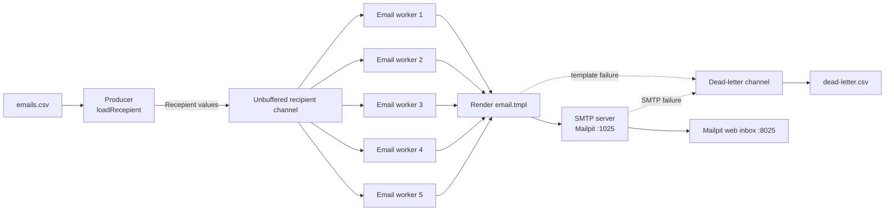

# MailStream

MailStream is a small Go email-campaign service that reads recipients from a
CSV file, renders an email template for each recipient, and sends messages
through an SMTP server. It uses Go channels and a worker pool to process
multiple recipients concurrently. Failed deliveries are recorded in a local
dead-letter queue (DLQ) instead of stopping the entire campaign.

The project is configured to work out of the box with
[Mailpit](https://github.com/axllent/mailpit), a local SMTP testing server with
a browser-based inbox.

## Features

- Reads recipient names and email addresses from `emails.csv`.
- Uses a Go channel to connect the producer and consumers.
- Processes recipients with five concurrent email workers.
- Renders each message using `email.tmpl`.
- Sends email through SMTP using Go's standard `net/smtp` package.
- Writes template and SMTP failures to `dead-letter.csv`.
- Keeps processing other recipients when an individual email fails.
- Waits for all email workers and the DLQ writer to finish before exiting.
- Appends DLQ records across runs and creates the CSV header when needed.

## Architecture

MailStream follows a producer-consumer architecture:



### Components

| Component | File | Responsibility |
| --- | --- | --- |
| Application entrypoint | `main.go` | Creates channels, starts the producer and workers, and coordinates shutdown |
| Producer | `producer.go` | Reads `emails.csv` and publishes `Recepient` values |
| Email workers | `consumer.go` | Render and send messages concurrently |
| Template renderer | `main.go` | Loads `email.tmpl` and executes it with recipient data |
| DLQ writer | `dead_letter.go` | Persists failed deliveries to `dead-letter.csv` |
| Message template | `email.tmpl` | Defines the SMTP message headers and body |
| Recipient input | `emails.csv` | Contains the campaign recipient list |

The code currently uses the existing `Recepient` type name for compatibility
with the project. Although the conventional spelling is `Recipient`, changing
the type would be an API-level code change within the package.

## Message flow

1. `main` creates an unbuffered recipient channel and a dead-letter channel.
2. The producer opens `emails.csv`, skips its header row, and sends each
   recipient to the recipient channel.
3. Five workers receive recipients from the channel. Each worker:
   - Loads and executes `email.tmpl`.
   - Sends the rendered message to the configured SMTP endpoint.
   - Logs successful delivery.
4. If template rendering fails, the worker writes a DLQ record with reason
   `template`.
5. If SMTP delivery fails, the worker writes a DLQ record with reason `smtp`.
6. The producer closes the recipient channel after all rows are published.
7. Once all email workers finish, `main` closes the dead-letter channel.
8. The DLQ writer drains the channel, flushes records to disk, and the process
   exits after the DLQ writer completes.

The channels are unbuffered, so sending a value synchronizes the producer and
consumers. The worker pool provides concurrency while the wait groups provide
an orderly shutdown.

## Requirements

- Go `1.26.4` or a compatible Go version supported by the project
- Docker, if using Mailpit
- An SMTP server reachable at the configured host and port

## Quick start with Mailpit

### 1. Start Mailpit

From PowerShell, run:

```powershell
docker run -d `
  --restart unless-stopped `
  --name mailpit `
  -p 8025:8025 `
  -p 1025:1025 `
  axllent/mailpit
```

Mailpit exposes:

- SMTP: `localhost:1025`
- Web inbox: <http://localhost:8025>

### 2. Run the application

Run the application from the repository root so its relative paths can locate
`emails.csv` and `email.tmpl`:

```powershell
go run .
```

The console displays worker activity. Open <http://localhost:8025> to inspect
the messages captured by Mailpit.

### 3. Build and run a binary

```powershell
go build -o mailstream.exe .
.\mailstream.exe
```

## Input format

`emails.csv` must contain a header row followed by two columns:

```csv
Name,Email
User 1,user1@example.com
User 2,user2@example.com
```

The producer expects the first column to be the recipient's name and the
second column to be the recipient's email address. The current implementation
does not validate email addresses before sending.

## Email template

The default `email.tmpl` is a plain-text SMTP message:

```text
To: {{.Email}}
Subject: Hello, {{.Name}}

Hi {{.Name}}

Thanks,
From Maaz Amir's team.
```

The template can use the following values:

| Template expression | Value |
| --- | --- |
| `{{.Name}}` | Recipient name from column one |
| `{{.Email}}` | Recipient email from column two |

The template must include valid message headers such as `To` and `Subject`,
followed by a blank line and the message body.

## Dead-letter queue

The DLQ is a local append-only CSV file named `dead-letter.csv`. A failed
recipient is not retried automatically; instead, one record is written with:

| Column | Description |
| --- | --- |
| `timestamp` | UTC time at which the failure was written |
| `name` | Recipient name |
| `email` | Recipient email |
| `reason` | `template` or `smtp` |
| `error` | Error returned by template rendering or SMTP |

Example:

```csv
timestamp,name,email,reason,error
2026-10-16T16:30:00Z,User 1,user1@example.com,smtp,dial tcp [::1]:1025: connectex: No connection could be made
```

Because the file is opened with append mode, existing records remain available
after later runs. Review the file to identify failures and correct the source
data or SMTP configuration before manually reprocessing those recipients.

If the DLQ file cannot be opened or written, the application logs the error.
The original recipient processing continues, but that failure record cannot be
recovered by this local queue.

## Configuration

The current SMTP settings are defined in `consumer.go`:

| Setting | Current value |
| --- | --- |
| SMTP host | `localhost` |
| SMTP port | `1025` |
| Sender address | `rakesh@codersgyan.com` |
| Worker count | `5` |
| Recipient input | `./emails.csv` |
| Template path | `email.tmpl` |
| DLQ path | `dead-letter.csv` |

The SMTP client currently sends without authentication, which is appropriate
for a local Mailpit instance but should not be used unchanged with a
production SMTP provider. For production use, these values should be moved to
environment variables or another configuration mechanism, and SMTP
authentication and TLS should be configured.

## Project layout

```text
MailStream/
├── consumer.go       # Concurrent email workers
├── dead_letter.go    # Dead-letter queue writer
├── email.tmpl        # Message template
├── emails.csv        # Recipient input
├── go.mod            # Go module metadata
├── info.md           # Mailpit setup note
├── main.go           # Entrypoint and template execution
├── producer.go       # CSV producer
└── README.md         # Project documentation
```

## Development and validation

Run the test suite:

```powershell
go test ./...
```

Run static analysis:

```powershell
go vet ./...
```

Format the Go source files:

```powershell
gofmt -w *.go
```
